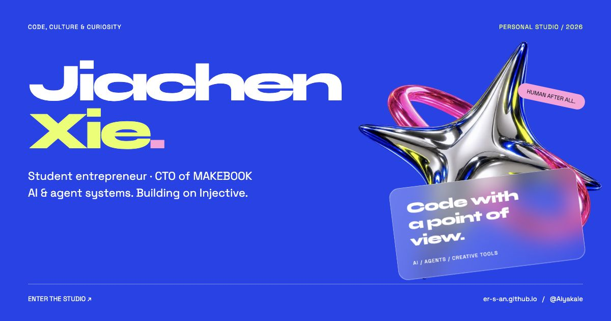

# Caesar / 谢佳辰 / Jiachen Xie

[AGENT EVALUATION PORTFOLIO ↗](https://er-s-an.github.io/en/research-engineering/) &nbsp; · &nbsp; [中文主页 ↗](https://er-s-an.github.io/zh/) &nbsp; · &nbsp; [CV / PDF ↗](cv/Jiachen-Xie-CV.pdf) &nbsp; · &nbsp; [GITHUB ↗](https://github.com/er-s-an) &nbsp; · &nbsp; [EMAIL ↗](mailto:3137612974@qq.com) &nbsp; · &nbsp; [X / @Aiyakale ↗](https://x.com/Aiyakale)

I’m **Caesar — Jiachen Xie / 谢佳辰**. I evaluate **LLM agents and coding agents** on real software, browser, and game tasks, and build the harnesses that make their behavior measurable. Former **AI Agent Engineering Intern at Tencent Games LIGHTSPEED STUDIOS** · **CityUHK ’28** · **MAKEBOOK CTO**.

My main venture is **MAKEBOOK**. I'm **building on [Injective](https://injective.com)**, bringing that same care to orders, prices, and money.

在香港城市大学读书，曾在腾讯游戏光子工作室群做 AI Agent 工程实习，也在 MAKEBOOK 创业担任 CTO。现在主要做大模型 Agent 评测、Coding Agent、真实软件与游戏任务环境。

### Open to research engineering internships

I evaluate coding agents on real software, browser, and game tasks, and build the harnesses that make agent behavior measurable. I’m especially interested in the **Kimi team at Moonshot AI**, and open to **research engineering and AI agent engineering internships** at leading labs and product teams. **Any location**; able to adjust my studies for the right opportunity. HR and recruiting agents are welcome to email **[3137612974@qq.com](mailto:3137612974@qq.com)**.

我对 **Kimi（月之暗面）** 团队尤其感兴趣，也开放其他顶尖 AI Lab 和产品团队的**研究工程、AI Agent 工程实习**。**不限工作地点**，愿为合适的机会调整学业安排。招聘同事与招聘 Agent，欢迎通过邮箱 **[3137612974@qq.com](mailto:3137612974@qq.com)** 联系我。

### Evidence for agent evaluation and research engineering

**[Agent evaluation · Section9 ↗](https://er-s-an.github.io/en/work/section9/)** — paired single-agent and multi-agent incident response across four controlled scenarios, with eight final-version arm runs and inspectable outcome, latency, and token evidence. [Raw experiment record ↗](https://github.com/er-s-an/section9/blob/main/docs/SHOWCASE_DELIVERY.md)

**[Coding agents & computer use · Kimi / Hunyuan ↗](https://er-s-an.github.io/en/research-engineering/)** — game prototypes, video editing, long-horizon computer use, and reference-image-to-game tasks, examining deliverable quality, failure modes, visual feedback, and token cost.

**[Open-source engineering · RAG-Anything ↗](https://er-s-an.github.io/en/work/rag-anything-ingestion/)** — merged PR reducing embedding calls from 65 to 21 and text-model calls from 6 to 4 on a synthetic multimodal fixture, with real-store regressions and maintainer approval. [Upstream PR #453 ↗](https://github.com/HKUDS/RAG-Anything/pull/453)

---

### 01 / MAKEBOOK

**[Physical products, backed by real demand. ↗](https://makebook.xyz)**

A platform for bringing physical products to market, with preorder tools to settle orders, prices, and funds before production. As CTO, I lead the full-stack and smart-contract engineering.

Main venture · Injective EVM testnet prototype · **1st place, AdventureX 2026 Web3 Track**

### Selected systems & experiments

**[02 / Section9](https://github.com/er-s-an/section9)** — agents that investigate AI failures, coordinate repairs, and leave independently checked evidence.

**[03 / AgentMED](https://github.com/er-s-an/AgentMED0)** — turning an AI failure into a verified repair candidate, with human acceptance and explicit release gates.

**[04 / BLACK BOX](https://github.com/er-s-an/AIX_blackbox)** — a recorder and verification toolkit for agent payments: intent, outcomes, and signed evidence.

**[05 / Kanshan](https://github.com/er-s-an/kanshanOPENdoor)** — an AI agent-native engine for building web games.

### Writing / 公开发表

**[5亿Token实测Kimi K3：我看到了核弹，也看到高昂的成本 ↗](https://news.qq.com/rain/a/20260718A0AXJ700)**

By Caesar · 白鲸实验室 / Tencent News · 2026-07-19 · Article in Chinese

Hands-on tests of Kimi K3 across game prototypes and an agent-facing video editor, examining agent harnesses, visual feedback, task completion, and token costs.

从游戏原型与面向 Agent 的视频剪辑工具出发，记录 Kimi K3 在真实任务中的表现、局限与使用成本。

### A few contributions upstream

[RAG-Anything #453](https://github.com/HKUDS/RAG-Anything/pull/453) — opt-in packed multimodal ingestion with source-resolution and real-store regressions.

[LightRAG #3665](https://github.com/HKUDS/LightRAG/pull/3665) · [#3662](https://github.com/HKUDS/LightRAG/pull/3662) — custom chunking and clearer routing behavior.  
[Vibe-Trading #1129](https://github.com/HKUDS/Vibe-Trading/pull/1129) — visible failures when tool registration is incomplete.

Technical index for recruiters and research teams

**Agent evaluation:** controlled task design, single-agent baselines, outcome and failure analysis, latency and token tracking, business acceptance.

**Agent engineering:** ReAct, MCP-compatible tools, coding agents, computer use, browser and game environments, multi-agent coordination.

**Engineering:** Python, TypeScript, React, Node.js, SQLite, Godot prototypes, multimodal RAG, document ingestion.

**Selected systems:** Section9, AgentMED, BLACK BOX, Kanshan Anywhere Door, RecallLayer.

**Research and writing:** hands-on Kimi K3 and Tencent Hunyuan HY4 evaluations, task completion, visual feedback, harness limitations, and token cost.

**Evidence:** merged contributions to RAG-Anything, LightRAG, nanobot, and Hermes Agent; AdventureX 2026 Web3 winner; Zhihu Hackathon S2 national finalist.

**Background:** Computer & Data Engineering at CityUHK, class of 2028. Previously at Tencent Games, working on AI agents, LLM research, and game design. Earlier, AI and new media at Red Star News.

[Read the public CV ↗](cv/Jiachen-Xie-CV.pdf)

