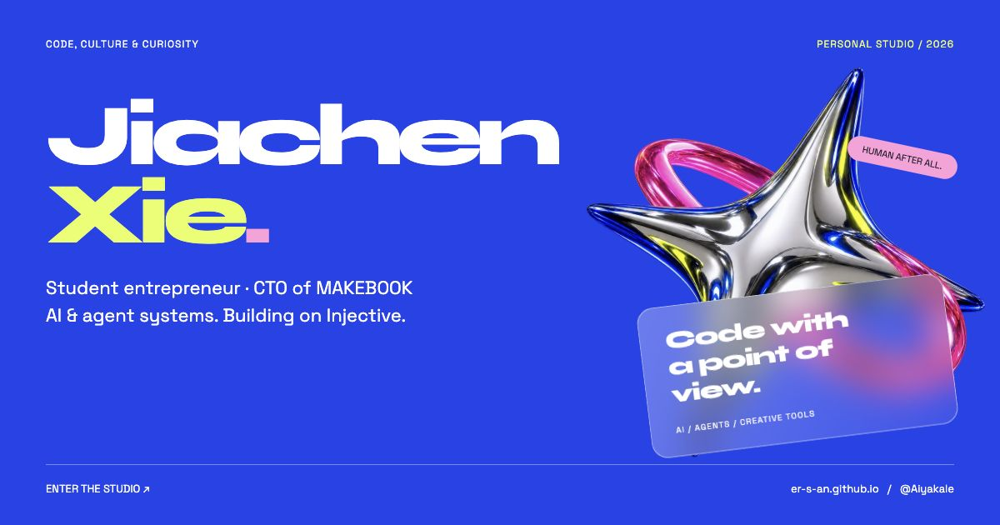

# Caesar / 谢佳辰 / Jiachen Xie

[STUDIO / EN ↗](https://er-s-an.github.io/en/) &nbsp; · &nbsp; [中文主页 ↗](https://er-s-an.github.io/zh/) &nbsp; · &nbsp; [CV / PDF ↗](cv/Jiachen-Xie-CV.pdf) &nbsp; · &nbsp; [MAKEBOOK ↗](https://makebook.xyz) &nbsp; · &nbsp; [X / @Aiyakale ↗](https://x.com/Aiyakale)

I’m **Caesar — Jiachen Xie / 谢佳辰**, a **student entrepreneur** and **CTO of MAKEBOOK**. I build **AI and agent systems**: collaboration, tool use, evaluation, and the interfaces that make them usable.

My main venture is **MAKEBOOK**. I'm **building on [Injective](https://injective.com)**, bringing that same care to orders, prices, and money.

在香港城市大学读书，也在 MAKEBOOK 创业，担任 CTO。做 AI Agent、创作工具与游戏，把点子写成能用的东西。

### Open to Kimi / Moonshot AI internships

I’m particularly interested in internship opportunities at **Kimi (Moonshot AI)**. I’m open to **any location** and willing to **take a break from my studies** for the right opportunity. HR and recruiting agents are welcome to reach out via **[X / @Aiyakale](https://x.com/Aiyakale)**. [Read my CV ↗](cv/Jiachen-Xie-CV.pdf)

我对 **Kimi（月之暗面）** 的实习机会非常感兴趣，**不限工作地点**，愿为合适的机会安排 **gap**。招聘同事与招聘 Agent，欢迎通过 **[X / @Aiyakale](https://x.com/Aiyakale)** 联系我。

---

### 01 / MAKEBOOK

**[Physical products, backed by real demand. ↗](https://makebook.xyz)**

A platform for bringing physical products to market, with preorder tools to settle orders, prices, and funds before production. As CTO, I lead the full-stack and smart-contract engineering.

Main venture · Injective EVM testnet prototype · **1st place, AdventureX 2026 Web3 Track**

### Selected systems & experiments

**[02 / Section9](https://github.com/er-s-an/section9)** — agents that investigate AI failures, coordinate repairs, and leave independently checked evidence.

**[03 / AgentMED](https://github.com/er-s-an/AgentMED0)** — turning an AI failure into a verified repair candidate, with human acceptance and explicit release gates.

**[04 / BLACK BOX](https://github.com/er-s-an/AIX_blackbox)** — a recorder and verification toolkit for agent payments: intent, outcomes, and signed evidence.

**[05 / Kanshan](https://github.com/er-s-an/kanshanOPENdoor)** — an AI agent-native engine for building web games.

### Writing / 公开发表

**[5亿Token实测Kimi K3：我看到了核弹，也看到高昂的成本 ↗](https://news.qq.com/rain/a/20260718A0AXJ700)**

By Caesar · 白鲸实验室 / Tencent News · 2026-07-19 · Article in Chinese

Hands-on tests of Kimi K3 across game prototypes and an agent-facing video editor, examining agent harnesses, visual feedback, task completion, and token costs.

从游戏原型与面向 Agent 的视频剪辑工具出发，记录 Kimi K3 在真实任务中的表现、局限与使用成本。

### A few contributions upstream

[LightRAG #3665](https://github.com/HKUDS/LightRAG/pull/3665) · [#3662](https://github.com/HKUDS/LightRAG/pull/3662) — custom chunking and clearer routing behavior.  
[Vibe-Trading #1129](https://github.com/HKUDS/Vibe-Trading/pull/1129) — visible failures when tool registration is incomplete.

A little more about me

谢佳辰 / Jiachen Xie. Computer & Data Engineering at CityUHK, class of 2028.

Previously at Tencent Games, working on AI agents, LLM research, and game design. Earlier, AI and new media at Red Star News.

I work mostly with Python, TypeScript, MCP, and Solidity. I also like the space where software becomes an experience: game systems, narrative interfaces, and tools with a point of view.

[Read the public CV ↗](cv/Jiachen-Xie-CV.pdf)

